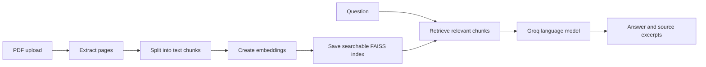

<div align="center">

# LegalEagle

### Ask questions about a contract. Get answers grounded in its pages.

An open-source document Q&A app built with Streamlit, LangChain, FAISS, and Groq.

[Get started](#-get-started) · [Try a question](#-try-a-question) · [How it works](#-how-it-works)


</div>

---

## What it does

LegalEagle lets you upload a PDF, ask a question in plain language, and review an answer alongside excerpts retrieved from the document. It creates embeddings locally with `sentence-transformers/all-MiniLM-L6-v2`, searches a FAISS index, and sends the retrieved context to Groq's `openai/gpt-oss-120b` model.

> **This is a document assistant, not a lawyer.** Its output can be incomplete or incorrect. Verify important conclusions against the original document and consult a qualified legal professional.

## Explore

- [Features](#-features)
- [Get started](#-get-started)
- [Try a question](#-try-a-question)
- [How it works](#-how-it-works)

## ✨ Features

- Upload a PDF contract or other legal document.
- Ask free-form questions about the indexed document.
- Review retrieved source excerpts with page numbers.
- Keep your Groq API key out of source code by entering it in the password field or setting an environment variable.
- Reuse a locally saved FAISS index between app runs when the host's filesystem persists.

## 🚀 Get started

### Requirements

- Python 3.10 or later
- A [Groq API key](https://console.groq.com/keys)

### Install

```bash
git clone https://github.com/singhdeepesh20/LegalEagle.git
cd LegalEagle
python -m venv .venv
```

Activate the virtual environment:

<details>
<summary>macOS / Linux</summary>

```bash
source .venv/bin/activate
```

</details>

<details>
<summary>Windows PowerShell</summary>

```powershell
.venv\Scripts\Activate.ps1
```

</details>

Install dependencies and start Streamlit:

```bash
python -m pip install -r requirements.txt
streamlit run app.py
```

Open the local URL printed by Streamlit, enter your Groq API key, upload a PDF, and ask a question.

## 💬 Try a question

After uploading a document, try asking:

- “What is the termination notice period?”
- “How are payment dates and late fees described?”
- “Which responsibilities does each party have?”
- “Does the document describe renewal or cancellation?”

These are example prompts, not guaranteed analyses. Answers depend on the document text retrieved for each question.

## ⚙️ How it works



1. `PyPDFLoader` extracts document pages.
2. The text is split into overlapping chunks and embedded using Sentence Transformers.
3. FAISS stores the vectors locally and retrieves up to five relevant chunks for a question.
4. LangChain passes the question and retrieved context to Groq and returns the answer with source documents.
