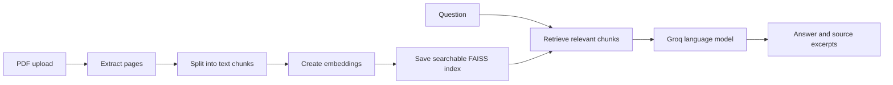

<div align="center">

# LegalEagle

### Ask questions about a contract. Get answers grounded in its pages.

An open-source document Q&A app built with Streamlit, LangChain, FAISS, and Groq.

[Get started](#-get-started) · [Try a question](#-try-a-question) · [How it works](#-how-it-works)


</div>

---

## What it does

LegalEagle lets you upload a PDF, ask a question in plain language, and review an answer alongside excerpts retrieved from the document. It creates embeddings locally with `sentence-transformers/all-MiniLM-L6-v2`, searches a FAISS index, and sends the retrieved context to Groq's `openai/gpt-oss-120b` model.

> **This is a document assistant, not a lawyer.** Its output can be incomplete or incorrect. Verify important conclusions against the original document and consult a qualified legal professional.

## Explore

- [Features](#-features)
- [Get started](#-get-started)
- [Try a question](#-try-a-question)
- [How it works](#-how-it-works)

## ✨ Features

- Upload a PDF contract or other legal document.
- Ask free-form questions about the indexed document.
- Review retrieved source excerpts with page numbers.
- Keep your Groq API key out of source code by entering it in the password field or setting an environment variable.
- Reuse a locally saved FAISS index between app runs when the host's filesystem persists.

## 🚀 Get started

### Requirements

- Python 3.10 or later
- A [Groq API key](https://console.groq.com/keys)

### Install

```bash
git clone https://github.com/singhdeepesh20/LegalEagle.git
cd LegalEagle
python -m venv .venv
```

Activate the virtual environment:

<details>
<summary>macOS / Linux</summary>

```bash
source .venv/bin/activate
```

</details>

<details>
<summary>Windows PowerShell</summary>

```powershell
.venv\Scripts\Activate.ps1
```

</details>

Install dependencies and start Streamlit:

```bash
python -m pip install -r requirements.txt
streamlit run app.py
```

Open the local URL printed by Streamlit, enter your Groq API key, upload a PDF, and ask a question.

## 💬 Try a question

After uploading a document, try asking:

- “What is the termination notice period?”
- “How are payment dates and late fees described?”
- “Which responsibilities does each party have?”
- “Does the document describe renewal or cancellation?”

These are example prompts, not guaranteed analyses. Answers depend on the document text retrieved for each question.

## ⚙️ How it works



1. `PyPDFLoader` extracts document pages.
2. The text is split into overlapping chunks and embedded using Sentence Transformers.
3. FAISS stores the vectors locally and retrieves up to five relevant chunks for a question.
4. LangChain passes the question and retrieved context to Groq and returns the answer with source documents.

## 🔐 Configuration

The app prompts for a Groq API key. To prefill that field, set `GROQ_API_KEY` before starting the app:

<details>
<summary>macOS / Linux</summary>

```bash
export GROQ_API_KEY="your-groq-api-key"
streamlit run app.py
```

</details>

<details>
<summary>Windows PowerShell</summary>

```powershell
$env:GROQ_API_KEY = "your-groq-api-key"
streamlit run app.py
```

</details>

Do not commit API keys to Git or paste them into public issues.

## ☁️ Deployment

LegalEagle is a **Streamlit application**. Deploy it on a host that runs Streamlit, such as [Streamlit Community Cloud](https://share.streamlit.io/):

1. Connect the GitHub repository.
2. Select the `main` branch and set `app.py` as the app file.
3. Deploy and provide the Groq API key in the app, or configure `GROQ_API_KEY` in the host's environment settings.

Vercel's Python Functions runtime expects an HTTP handler export such as `app`, `application`, or `handler`. This project does not provide that interface; adding a placeholder export does not make the Streamlit app run on Vercel. A Vercel deployment would require a separate adaptation of the app.

## ⚠️ Important limitations

- **Not legal advice:** The app may miss clauses, misunderstand language, or generate inaccurate statements. Review the original PDF and seek qualified legal advice for consequential decisions.
- **Document scope:** The app builds one FAISS index from the uploaded PDF. Uploading another PDF replaces the saved local index; this is not multi-document search.
- **External processing:** PDF text is embedded locally, but retrieved document excerpts and your question are sent to Groq to generate an answer. Do not upload sensitive documents unless you are comfortable with this processing.
- **Local persistence:** Uploaded PDFs and the FAISS index are stored on the app's local filesystem. Temporary or ephemeral hosting may remove them when the app restarts or redeploys.
- **PDF quality:** Scanned or image-only PDFs may not contain extractable text and may need OCR before upload.

## 🗂️ Project structure

```text
LegalEagle/
├── app.py            # Streamlit interface
├── backend.py        # PDF ingestion, embeddings, retrieval, and QA
├── requirements.txt  # Python dependencies
└── README.md
```

## 🧰 Built with

| Layer | Technology |
|---|---|
| Interface | [Streamlit](https://streamlit.io/) |
| PDF extraction | [pypdf](https://pypdf.readthedocs.io/) via LangChain |
| Text splitting and orchestration | [LangChain](https://www.langchain.com/) |
| Embeddings | [Sentence Transformers](https://www.sbert.net/) |
| Vector search | [FAISS](https://github.com/facebookresearch/faiss) |
| Language model API | [Groq](https://console.groq.com/) |

## 🤝 Contributing

Contributions and bug reports are welcome. For a useful report, include steps to reproduce the issue and relevant error output, but **never include API keys or confidential document contents**.

1. Fork the repository and create a feature branch.
2. Make a focused change and test it locally.
3. Open a pull request describing the change.

## 📄 License

This project is distributed under the [MIT License](./LICENSE).

---

<div align="center">

Questions or ideas? [Open an issue](https://github.com/singhdeepesh20/LegalEagle/issues).

</div>
